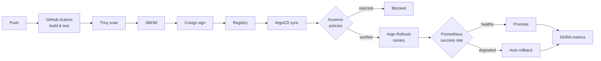

<div align="center">

<!-- Animated header -->


<br/>

<h3>🚀 BS CS @ University of Lahore (Sargodha Campus) &nbsp;·&nbsp; DevOps Intern ×2 @ PITB Lahore</h3>

<br/>

<p>
  <a href="https://github.com/saadhussain07?tab=followers">
    
  </a>
  <a href="https://orcid.org/0009-0003-9132-9986">
    
  </a>
  <a href="https://rocketdevops.vercel.app">
    
  </a>
</p>

</div>

---

## 🔬 Research

> **"Where Does the Accuracy of LLM-Based Root-Cause Analysis Come From? An Empirical Study on Microservice Benchmarks"**
> M. S. Hussain, A. Farrukh · *Under review, Empirical Software Engineering* (Springer)
> 📦 [Replication package](https://github.com/saadhussain07/llm-rca-accuracy-study) · [Pre-registration record](https://github.com/saadhussain07/rca-benchmark-study) · [](https://doi.org/10.5281/zenodo.23409452)

> **"Auditing an LLM AIOps Agent Against Its Own Safety Mechanisms"**
> M. S. Hussain, M. A. Sultan, A. Farrukh · *Under review, Innovations in Systems and Software Engineering* (Springer)
> 📦 [Code & Data](https://github.com/saadhussain07/llm-aiops-safety-audit) · [](https://doi.org/10.5281/zenodo.22974350)

> **"Fine-Tuning Lightweight Transformer Models for Text Classification: A Comparative Analysis of DistilBERT, BERT, and LSTM"**
> H. Ali, M. Riaz, I. Ullah, M. S. Hussain, M. A. B. Sultan · *Journal of Engineering and Computational Intelligence Review*, 4(1), 2026 · [DOI](https://doi.org/10.63544/ggeppj73)

> **Key findings:** in a pre-registered study on 360 benchmark fault cases with three open-weight LLMs, the agent's accuracy came mostly from the evidence its pipeline extracted, and one false sentence in the context misled every model tested. An audit of its safety mechanisms found that five-way voting changed no verdict and no state-changing command executed as written.

---

## 👨‍💻 About Me

```yaml
name: Muhammad Saad Hussain
role: DevOps & Cloud Engineer · DevSecOps · AIOps Researcher
location: Sargodha, Pakistan
education: BS Computer Science @ University of Lahore

currently:
  - Building intelligent self-healing cloud-native systems
  - Building secure GitOps delivery: scan, sign, admit, roll back
  - SecAIOps: LLM-driven security anomaly detection (final-year project)
  - Maintaining RocketDevOps — a live learning platform for students

experience:
  - company: PITB Lahore (Punjab IT Board)
    role: DevOps Engineering Intern
    period: Sep – Oct 2025
  - company: PITB Lahore (Punjab IT Board)
    role: DevOps Engineering Intern
    period: Aug – Sep 2026

tools_i_use_daily:
  - Linux · Docker · Kubernetes · Helm · ArgoCD
  - Terraform · Ansible · Jenkins · GitLab CI/CD · GitHub Actions
  - Trivy · Cosign · Kyverno · Falco
  - Prometheus · Grafana · Loki · Jaeger
  - AWS · Python · Bash

fun_fact: Calm on the outside. Chaotic in my terminal. 🖥️
```

---

## 🛠️ Tech Stack

### ☁️ Cloud & Infrastructure
<p>
  
  
  
</p>

### 🐳 Containers & Orchestration
<p>
  
  
  
  
</p>

### 🔁 CI/CD & Version Control
<p>
  
  
  
  
</p>

### 🛡️ DevSecOps
<p>
  
  
  
  
  
</p>

### 📊 Observability & AIOps
<p>
  
  
  
  
  
</p>

### 🐧 OS & Scripting
<p>
  
  
  
</p>

---

## 🛡️ DevSecOps: DevBoard

**Secure GitOps delivery platform**, built in 7 days for the TWS Phase 3 Hackathon (one of 10 finishers in the batch) · [Repository](https://github.com/saadhussain07/DEVBOARD)

Every image is scanned, described (SBOM), signed and verified before it runs, and every release rolls itself back if it degrades.



---

## 📌 Featured Projects

| # | Project | Description | Stack |
|---|---------|-------------|-------|
| 🛡️ | [DevBoard](https://github.com/saadhussain07/DEVBOARD-REPO-NAME) | Secure GitOps delivery — scan, SBOM, sign, policy-gated deploy, canary with auto-rollback, DORA metrics | GitHub Actions · Trivy · Cosign · Kyverno · ArgoCD · Argo Rollouts |
| 🤖 | [AIOps K8s Framework](https://github.com/saadhussain07/fgcs-aiops-llm-agent) | Telemetry-driven LLM agent for fault detection & advisory remediation — the system studied in both papers under review, code + all cycle data public | Python · LLM · Prometheus · Loki · Jaeger · K8s |
| 🌐 | [RocketDevOps](https://github.com/saadhussain07/devops_site) | Live DevOps learning platform — [rocketdevops.vercel.app](https://rocketdevops.vercel.app) | HTML · CSS · JS · Vercel |
| 🦊 | [GitLab CI/CD Projects](https://github.com/saadhussain07/gitlab-cicd-projects) | Real pipelines on **self-hosted GitLab** — build, test, push, deploy | GitLab CI · Docker · Docker Hub |
| ⚙️ | [Flask GitOps ArgoCD](https://github.com/saadhussain07/flask-gitops-argocd-kubernetes-Project) | End-to-end GitOps pipeline — image → registry → ArgoCD → K8s | Flask · Docker · Helm · ArgoCD |
| 📊 | [K8s Monitoring Stack](https://github.com/saadhussain07/k8s-monitoring-stack) | Full observability stack with alerting on Kubernetes | Prometheus · Grafana · Loki · AlertManager |
| 🏗️ | [Terraform AWS Infra](https://github.com/saadhussain07/terraform-aws-infra) | Modular AWS infra — VPC, EKS, RDS, IAM | Terraform · AWS |
| 🤖 | [Ansible Playbooks](https://github.com/saadhussain07/ansible-playbooks) | Production-grade automation roles — Docker, K8s, Nginx | Ansible |
| ☸️ | [K8s Practice Manifests](https://github.com/saadhussain07/k8s-practice-manifests) | 15+ topics — RBAC, HPA, Network Policies, SSL/TLS, PVs | Kubernetes · YAML |
| 🐧 | [DevOps Linux Scripts](https://github.com/saadhussain07/devops-linux) | Bash automation — health checks, disk cleanup, log analysis | Bash · Linux |
| 🗺️ | [My DevOps Journey](https://github.com/saadhussain07/My_DevOps_Journey) | Full learning roadmap from Linux → AIOps, with structured notes | Markdown |

---

## 📊 GitHub Stats

<div align="center">


<br/>


<br/>


</div>

---

## 🗺️ My Learning Path

```
Linux & Git  →  Docker  →  Kubernetes  →  CI/CD (Jenkins/GitLab)  →  Cloud (AWS)
     ↓
IaC (Terraform + Ansible)  →  GitOps (ArgoCD)  →  Observability (Prometheus/Grafana/Loki)
     ↓
DevSecOps (Trivy · Cosign · Kyverno · Falco)  →  🤖 AIOps  ← [ CURRENT FOCUS ]
```

---

## 🤝 Connect with Me

<p align="left">
  <a href="https://www.linkedin.com/in/muhammad-saad-hussain-28435b3a2/" target="_blank">
    
  </a>
  <a href="https://rocketdevops.vercel.app" target="_blank">
    
  </a>
  <a href="mailto:muhammadsaadhussain49@gmail.com">
    
  </a>
  <a href="https://github.com/saadhussain07">
    
  </a>
  <a href="https://orcid.org/0009-0003-9132-9986" target="_blank">
    
  </a>
</p>

---

<div align="center">


<br/>

*DevOps is not a destination — it's a continuous loop* 🔄

⭐ **If my work helps you, a star on any repo means a lot!**

</div>
